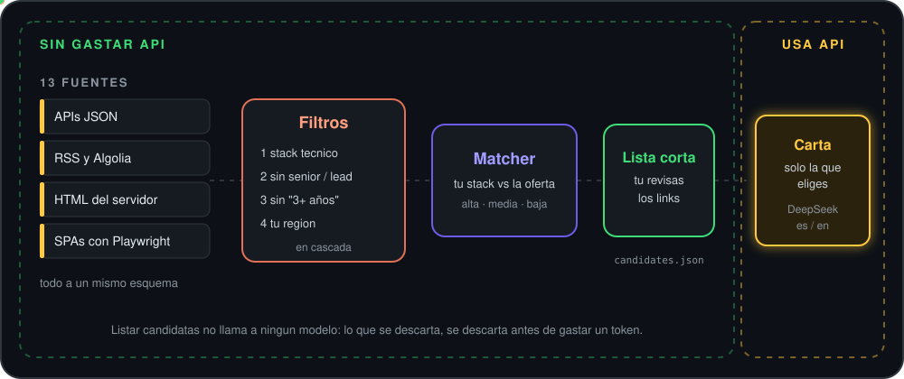
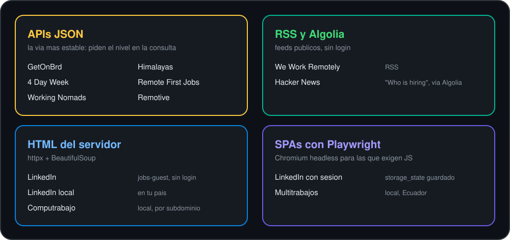

<div align="center">



### Ofertas de 13 fuentes en una sola lista corta, filtrada contra tu perfil.

<br/>



<br/><br/>

[](#fuentes)
[](#por-que)
[](#como-se-usa)
[](#como-se-usa)

[](https://python.org)
[](https://playwright.dev)
[](https://www.python-httpx.org)
[](https://platform.deepseek.com)
[](https://github.com/Mickaell22/ApplyJob)

[**Por que**](#por-que) • [**Fuentes**](#fuentes) • [**Como se usa**](#como-se-usa) • [**Instalacion**](#instalacion) • [**Documentacion**](#documentacion)

</div>

---

## Por que

Revisar ofertas en una docena de plataformas es lento: cada una tiene su formato y la mayoria de lo que devuelven no aplica a tu perfil. ApplyJob las junta en un mismo esquema, descarta lo que no encaja y te deja **una lista corta para revisar a mano**.

- **Listar es gratis.** Descubrir, filtrar y puntuar no llama a ningun modelo. Lo que se descarta, se descarta antes de gastar un token.
- **Tu decides.** La carta se genera solo para la oferta que elegiste, despues de abrir el link. No postula por ti.
- **Un matcher que no se descalibra.** Busca tu stack con limite de palabra (`java` no matchea `javascript`) y mide por cantidad de coincidencias, no por porcentaje.

---

## Fuentes

<p align="center">
  
</p>

Hay dos canales: **remoto** (filtra por las restricciones de region de cada oferta) y **local** (busca en tu pais y acepta presencial o hibrido). La tabla con el filtro de seniority de cada fuente esta en [docs/USO.md](docs/USO.md#descubrir-y-generar-cartas).

---

## Como se usa

<table>
<tr>
<td width="33%" valign="top">

### 1. Descubrir

**Sin API.**

```bash
python cli/run_discover.py
```

Junta, filtra y puntua. Deja la lista en `output/cartas/candidates_<fecha>.json` y no repite lo que ya viste.

</td>
<td width="33%" valign="top">

### 2. Revisar

**Lo haces tu.**

Abres los links de la lista y decides a cual postular. Las marcadas con `[!]` tienen la ubicacion ambigua: revisalas antes.

</td>
<td width="33%" valign="top">

### 3. Carta

**Con DeepSeek.**

```bash
python cli/gen_cover.py \
  --from-json <lista> --pick 3
```

Primero evalua la oferta: si sale `Skip`, no gasta en la carta.

</td>
</tr>
</table>

Las cartas salen en español o en ingles desde el mismo `profile/cv.md`, y se pasan a PDF con `src/letter_to_pdf.py`.

---

## Instalacion

```bash
git clone https://github.com/Mickaell22/ApplyJob.git && cd ApplyJob
python3 -m venv .venv && source .venv/bin/activate
pip install -r requirements.txt && playwright install chromium
cp .env.example .env && cp profile/cv_template.md profile/cv.md   # y llenalos
```

Que va en el `.env`, de donde sacar cada clave y como armar tu perfil: [docs/INSTALACION.md](docs/INSTALACION.md).

---

## Documentacion

<table>
<tr>
<td width="33%" valign="top">

**[Instalacion](docs/INSTALACION.md)**<br/>
Variables del `.env`, credenciales de DeepSeek y Gmail, CVs y perfil.

</td>
<td width="33%" valign="top">

**[Uso](docs/USO.md)**<br/>
Todos los comandos, las fuentes, los filtros, el matcher y la estructura del repo.

</td>
<td width="33%" valign="top">

**[Formularios ATS](docs/ATS.md)**<br/>
Relleno asistido y opt-in de Workable y Greenhouse, y que plataformas no se pueden.

</td>
</tr>
</table>

Self-check del matcher: `.venv/bin/python3 tests/test_matcher.py`

---

## Licencia

MIT
